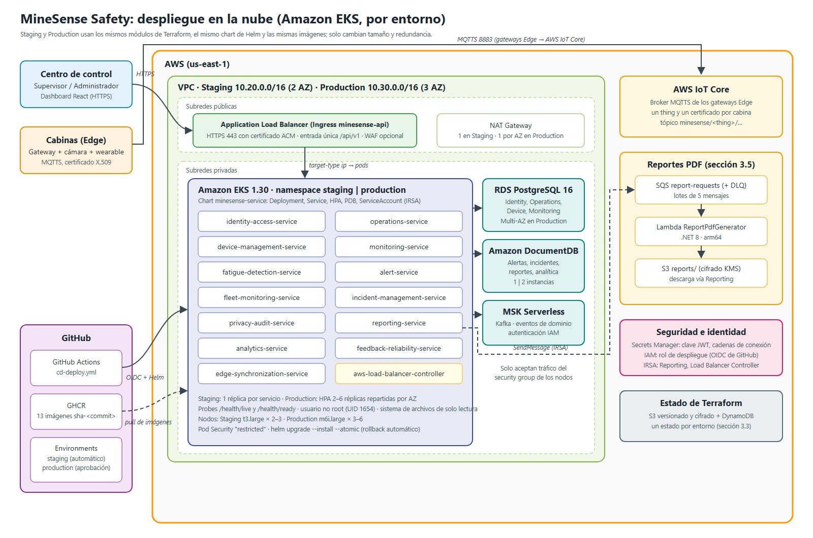
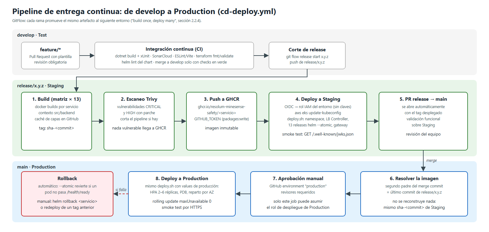

# Despliegue en cloud: Helm sobre Amazon EKS

Despliegue de los microservicios de MineSense Safety en los clústeres EKS que crea Terraform
(`infrastructure/terraform`, sección 3.3), conforme al ADR-008. Lo ejecuta el workflow
`.github/workflows/cd-deploy.yml` y también puede ejecutarse a mano con
`infrastructure/scripts/deploy.sh`.



## Estructura

```
infrastructure/
├── helm/
│   ├── minesense-service/        # Chart genérico de un microservicio .NET 8
│   │   └── templates/            # Deployment, Service, ConfigMap, ServiceAccount, HPA, PDB
│   ├── minesense-gateway/        # Ingress único /api/v1 (AWS Application Load Balancer)
│   └── values/
│       ├── environments/         # staging.yaml, production.yaml
│       └── services/             # un archivo por microservicio (13)
├── k8s/namespaces.yaml           # namespaces staging y production con Pod Security "restricted"
└── scripts/deploy.sh             # despliega todo un entorno (pipeline o manual)
```

Cada microservicio es un release de Helm con el mismo chart. Los valores se combinan en este
orden: `minesense-service/values.yaml` (base), `values/environments/<entorno>.yaml` y
`values/services/<servicio>.yaml`.

## Qué crea el chart por servicio

| Objeto | Detalle |
| --- | --- |
| Deployment | Rolling update con `maxUnavailable: 0`; probes `/health/live` y `/health/ready`; usuario no root (UID 1654), sin escalamiento de privilegios, capabilities eliminadas y sistema de archivos de solo lectura (solo `/tmp` es escribible). |
| Service | `ClusterIP` en el puerto 80 hacia el 8080 del contenedor. |
| ConfigMap | `ASPNETCORE_ENVIRONMENT` y la configuración no sensible (`Section__Key`). |
| ServiceAccount | Con la anotación `eks.amazonaws.com/role-arn` cuando el servicio necesita AWS (IRSA). |
| HPA y PDB | Solo en Production: de 2 a 6 réplicas por CPU (70 %) y al menos 1 réplica disponible. |

| Parámetro | Staging | Production |
| --- | --- | --- |
| Réplicas | 1 | HPA 2–6, repartidas por zona de disponibilidad |
| CPU / memoria solicitada | 100m / 192Mi | 250m / 256Mi |
| Límite de memoria | 384Mi | 512Mi |
| `ASPNETCORE_ENVIRONMENT` | Staging | Production |

## Entrada única /api/v1

`minesense-gateway` crea un Ingress que el AWS Load Balancer Controller convierte en un
Application Load Balancer público (HTTPS con certificado ACM y WAF opcional) que envía cada ruta
directamente a los pods. Las reglas se evalúan en orden, por eso las rutas específicas que caen
dentro del prefijo de otro servicio van primero:

| Ruta | Servicio |
| --- | --- |
| `/api/v1/operators/*/status` | fleet-monitoring-service (antes que `/api/v1/operators` de Operations) |
| `/api/v1/alerts/*/feedback`, `/api/v1/analytics/alert-reliability` | feedback-reliability-service |
| `/api/v1/auth`, `/authentication`, `/users`, `/.well-known/jwks.json` | identity-access-service |
| `/api/v1/mining-units`, `/mining-sites`, `/fleets`, `/vehicles`, `/operators`, `/operator-assignments`, `/shift-assignments` | operations-service |
| `/api/v1/devices` | device-management-service |
| `/api/v1/monitoring-sessions` | monitoring-service |
| `/api/v1/fatigue-assessments` | fatigue-detection-service |
| `/api/v1/alerts` | alert-service |
| `/api/v1/fleet-operators`, `/fleet`, `/fleet-monitoring` | fleet-monitoring-service |
| `/api/v1/incidents` | incident-management-service |
| `/api/v1/consents`, `/access-log`, `/processing-purposes`, `/audit` | privacy-audit-service |
| `/api/v1/report-definitions`, `/reports` | reporting-service |
| `/api/v1/analytics` | analytics-service |
| `/api/v1/synchronization-batches` | edge-synchronization-service |

> Cada prefijo tiene un solo dueño. Privacy & Audit publica su reporte de cumplimiento y la
> traza de accesos de un incidente bajo `/api/v1/audit/compliance-reports` y
> `/api/v1/audit/incidents/{id}/history`, así no choca con `/api/v1/reports` (Reporting) ni con
> `/api/v1/incidents` (Incident Management). Las pruebas `GatewayRoutingTests` de cada servicio
> verifican que todas sus rutas lleguen a él por el gateway.

## Prerrequisitos (una vez por entorno)

1. `terraform apply` de `bootstrap` (estado remoto y proveedor OIDC de GitHub) y del entorno
   (`environments/staging` o `environments/production`).
2. En GitHub, crear los environments `staging` y `production`; en `production`, activar
   *Required reviewers*. Variables de cada environment (salidas de Terraform):

   | Variable | Valor |
   | --- | --- |
   | `AWS_REGION` | `us-east-1` |
   | `EKS_CLUSTER_NAME` | `cluster_name` |
   | `VPC_ID` | VPC del entorno |
   | `AWS_DEPLOY_ROLE_ARN` | `github_deploy_role_arn` |
   | `AWS_LB_CONTROLLER_ROLE_ARN` | `load_balancer_controller_role_arn` |
   | `REPORTING_SERVICE_ROLE_ARN` | `reporting_service_role_arn` |
   | `KAFKA_BOOTSTRAP_SERVERS` | `kafka_bootstrap_brokers` (eventos de dominio, ADR-004; vacío = solo se registran en el log) |
   | `API_HOST`, `ACM_CERTIFICATE_ARN` | dominio y certificado del entorno (opcionales) |

   Y la variable de repositorio `EKS_DEPLOY_ENABLED=true` para activar los despliegues.
3. Crear los secretos de los servicios que los necesitan (en Secrets Manager y sincronizados al
   namespace, por ejemplo con External Secrets Operator, o a mano):

   ```bash
   kubectl -n staging create secret generic identity-access-secrets \
     --from-file=IdentityAccess__Jwt__PrivateKeyPem=jwt-private.pem \
     --from-literal=IdentityAccess__BootstrapAdministrator__Username=admin \
     --from-literal=IdentityAccess__BootstrapAdministrator__Password='<contraseña>'
   kubectl -n staging create secret generic feedback-reliability-secrets \
     --from-literal=ConnectionStrings__MongoDb='<cadena de DocumentDB>'
   # Contextos documentales (ADR-005): la misma cadena de DocumentDB; cada servicio usa su
   # propia base (MongoDb__Database en sus values: minesense_alerts, minesense_incidents...).
   for secret in alert incident-management fatigue-detection fleet-monitoring analytics \
       reporting privacy-audit edge-synchronization; do
     kubectl -n staging create secret generic "$secret-secrets" \
       --from-literal=ConnectionStrings__MongoDb='<cadena de DocumentDB>'
   done
   ```

   Todas las réplicas de Identity & Access deben compartir la misma clave privada; si no, un
   token emitido por un pod no es válido en otro.

## Pipeline



| Disparador | Qué hace |
| --- | --- |
| push a `release/*` | Construye las 13 imágenes una sola vez (`sha-<commit>`), las escanea con Trivy (CRITICAL/HIGH), las publica en GHCR, despliega en Staging y abre el PR `release/* → main`. |
| push a `main` | Toma el último commit de la rama release integrada (segundo padre del merge) y, tras la aprobación del environment `production`, despliega **las mismas imágenes** en Production. |
| `workflow_dispatch` | Despliega a mano un tag existente en Staging o Production (también sirve para volver a un tag anterior). |

Cada pull request que toca `infrastructure/helm` o `infrastructure/k8s` ejecuta
`helm-validate.yml`: `helm lint --strict` de los 13 servicios en ambos entornos y validación
de los manifiestos generados con kubeconform contra Kubernetes 1.30.

## Despliegue y rollback manual

```bash
aws eks update-kubeconfig --name minesense-staging --region us-east-1
infrastructure/scripts/deploy.sh staging sha-<commit>

# Un solo servicio
SERVICES="operations-service" infrastructure/scripts/deploy.sh staging sha-<commit>

# Volver a la revisión anterior de un servicio
helm history operations-service -n staging
helm rollback operations-service <revisión> -n staging
```

`helm upgrade --atomic` revierte automáticamente un release si sus pods no pasan
`/health/ready` en 5 minutos, de modo que un despliegue fallido no deja el entorno a medias.

## Verificación local de las imágenes

Las imágenes se probaron con las mismas restricciones del chart:

```bash
docker build -f src/backend/OperationsService/Dockerfile -t minesense/operations-service:local src/backend
docker run --rm --read-only --tmpfs /tmp --user 1654:1654 --cap-drop ALL \
  --security-opt no-new-privileges -e ASPNETCORE_ENVIRONMENT=Staging -p 5203:8080 \
  minesense/operations-service:local
curl localhost:5203/health/ready   # Healthy
```
